# Sprawozdanie – Gratyfikant GT

| | 
|---|
| **Mikołaj Pawłoś** |
| **258681** |

## Spis treści

- [Zadanie 1](#zadanie-1)
- [Zadanie 2](#zadanie-2)
- [Zadanie 3](#zadanie-3)
- [Zadanie 4](#zadanie-4)
- [Zadanie 5](#zadanie-5)
- [Zadanie 6](#zadanie-6)
- [Zadanie 7](#zadanie-7)
- [Zadanie 8](#zadanie-8)
- [Zadanie 9](#zadanie-9)
- [Zadanie 10](#zadanie-10)
- [Zadanie 11](#zadanie-11)
- [Zadanie 12](#zadanie-12)
- [Zadanie 13](#zadanie-13)
- [Zadanie 14](#zadanie-14)
- [Zadanie 15](#zadanie-15)
- [Zadanie 16](#zadanie-16)
- [Zadanie 17](#zadanie-17)
- [Zadanie 18](#zadanie-18)
- [Zadanie 19](#zadanie-19)
- [Zadanie 20](#zadanie-20)
- [Zadanie 21](#zadanie-21)
- [Zadanie 22](#zadanie-22)
- [Zadanie 23](#zadanie-23)
- [Zadanie 24](#zadanie-24)
- [Zadanie 25](#zadanie-25)
- [Zadanie 26](#zadanie-26)
- [Zadanie 27](#zadanie-27)
- [Zadanie 28](#zadanie-28)
- [Zadanie 29](#zadanie-29)
- [Zadanie 30](#zadanie-30)

## Zadanie 1

Dane firmy PHU Szkolenie sp. z o.o. wprowadzone kreatorem (szef: Mikołaj Pawłoś, identyfikator MP; pierwsza wypłata: lipiec 2026; zasiłki wypłaca ZUS; składki do 15. dnia następnego miesiąca). W zadaniu nie podano numeru NIP („NIP szkoły”), więc użyto numeru przykładowego 521-000-00-03.

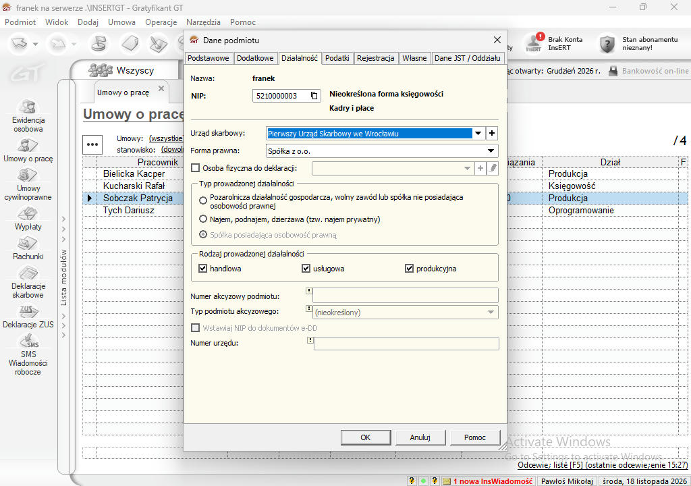

## Zadanie 2

Dodani pracownicy Rafał Kucharski i Patrycja Sobczak (dane osobowe, adres, urząd skarbowy, NFZ, wykształcenie).

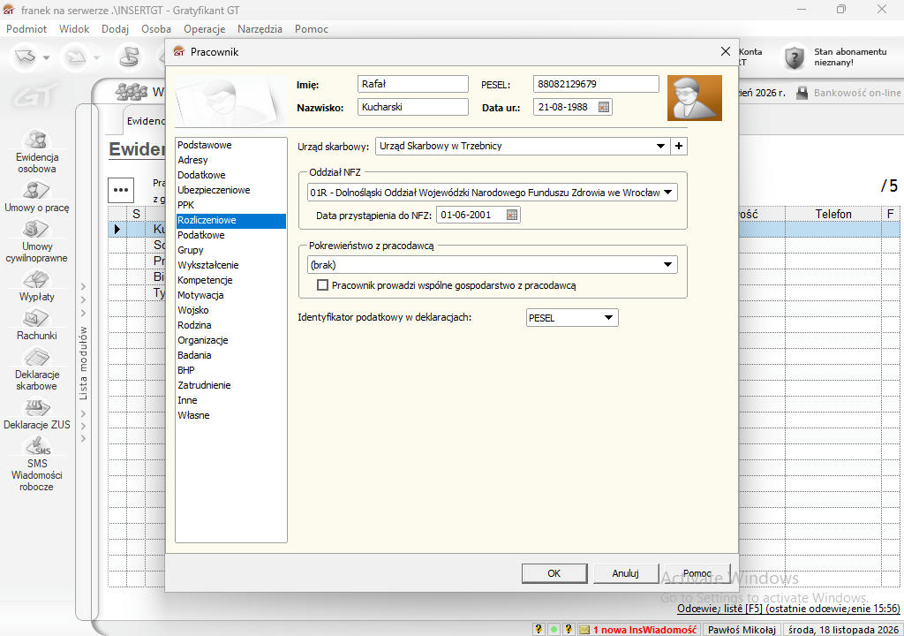

## Zadanie 3

Umowy o pracę od 1.07.2026: Rafał Kucharski (zestaw Administracja, podstawa 6 600 zł + premia uznaniowa 650 zł) i Patrycja Sobczak (zestaw Robotnicy, podstawa 5 000 zł).

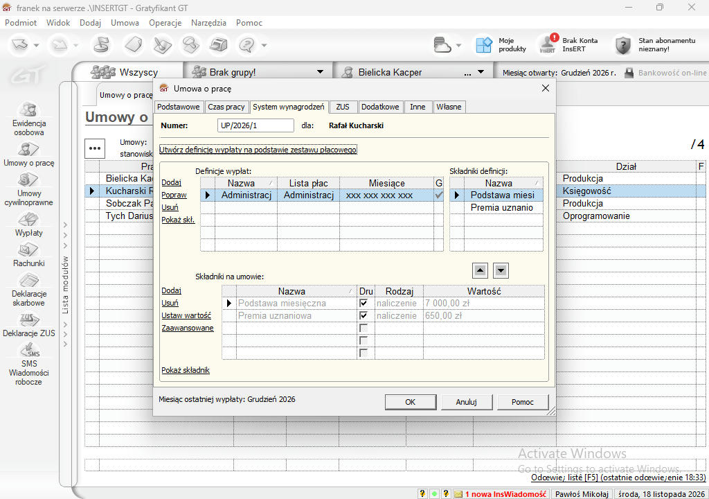

## Zadanie 4

Wygenerowane deklaracje PIT-2 za rok 2026 dla obu pracowników.

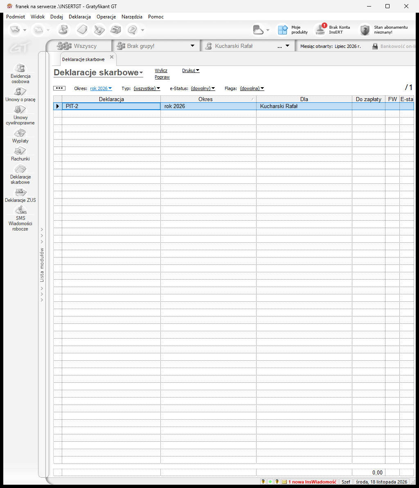

## Zadanie 5

W obu umowach ustawiono uprawnienie do ulgi podatkowej: odliczać 1/12.

## Zadanie 6

Wygenerowane deklaracje ZUS ZUA (zgłoszenie do ubezpieczeń) dla obu pracowników, data powstania obowiązku 1.07.2026.

## Zadanie 7

Wygenerowane listy płac za lipiec 2026 (Administracja i Robotnicy), wypłaty obu pracowników obliczone poprawnie.

## Zadanie 8

Absencja Rafała Kucharskiego: urlop wypoczynkowy 10–13.08.2026 (4 dni). Program ostrzegł, że wymiar należnego urlopu jest mniejszy od wykorzystywanego (pracownik zatrudniony od lipca); zapis zatwierdzono zgodnie z poleceniem.

## Zadanie 9

Absencja Patrycji Sobczak: choroba 18–23.08.2026, kod choroby A, nr zwolnienia XXX08/2026, data wpłynięcia 18.08.2026, kod świadczenia 313/331.

## Zadanie 10

Do dokumentu „Informacja o warunkach zatrudnienia (z regul.)” dodano punkt 6): „sposób potwierdzania przez pracowników przybycia i obecności w pracy: podpis na liście obecności”.

## Zadanie 11

Dodano pracownika Andrzeja Przybyła i jego umowę zlecenia (1.08–31.12.2026, kwota rachunku 3 000 zł, tytuł ubezpieczenia 0411, koszty 20%, zryczałtowany podatek 12%, treść: umowa zlecenia doraźnego). W programie lista dni miesiąca w harmonogramie kończy się na 28., dlatego rachunek cykliczny ustawiono na 28. dzień miesiąca (brak opcji „ostatni dzień”).

## Zadanie 12

Dodano pracownika Kacpra Bielickiego (w zadaniu: „Kacper Bielicka”) i umowę o pracę na czas określony 1.08.2026–31.01.2027 (zestaw Robotnicy, dział Produkcja, stolarz, podstawa 5 500 zł, ulga podatkowa 1/12). Wygenerowano deklaracje ZUA dla pracowników z zadań 11 i 12.

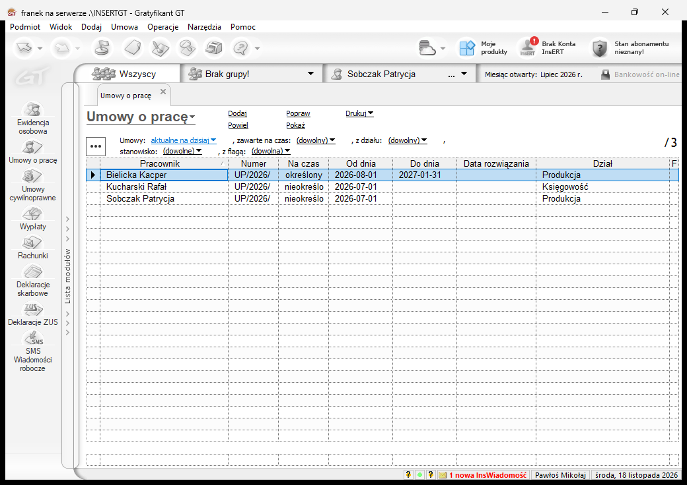

## Zadanie 13

W programie istniała już gotowa stawka „Krzesło” (20 zł), a nazwa stawki musi być unikalna, więc dodano nową stawkę liniową „krzesło - zestaw stolarza” (5 zł za sztukę). Wykonanie akordu: 250 szt. na dzień 31.08.2026, rozliczenie automatyczne – wartość 1 250 zł.

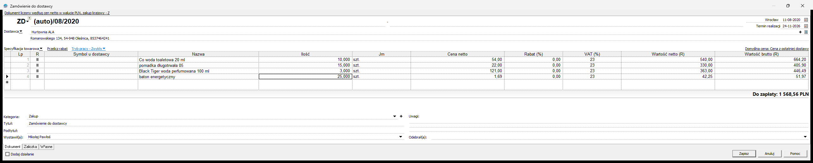

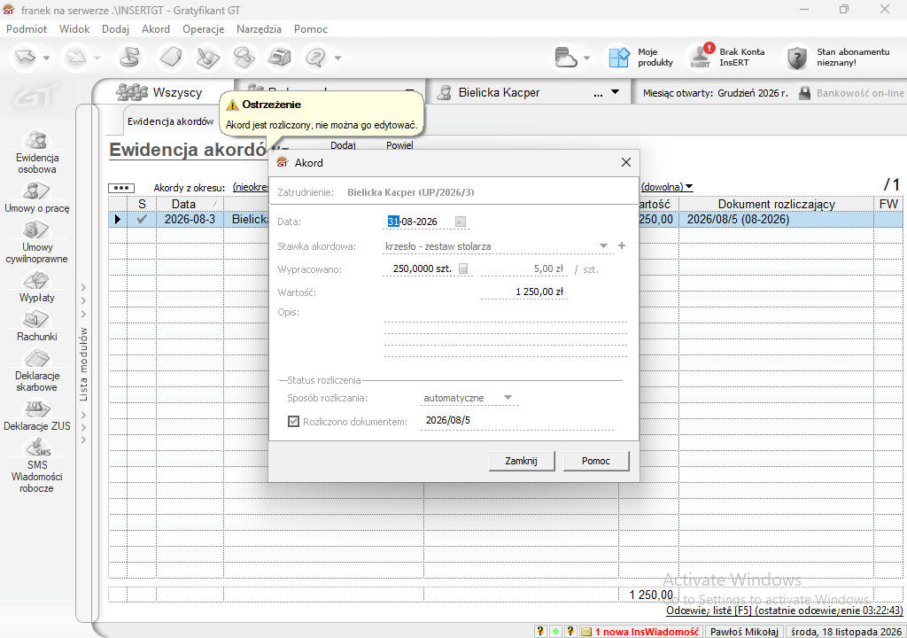

## Zadanie 14

Dla pracowników zatrudnionych na umowę o pracę (Kucharski, Sobczak, Bielicka) wprowadzono wyjątek czasu pracy: dzień wolny za święto 15.08.2026 (sobota) odebrany 17.08.2026 (typ dnia wolnego WWŚ).

## Zadanie 15

Sporządzono listy płac za sierpień 2026 oraz rachunek do umowy zlecenia (31.08.2026, brutto 3 000 zł, do wypłaty 2 106,72 zł).

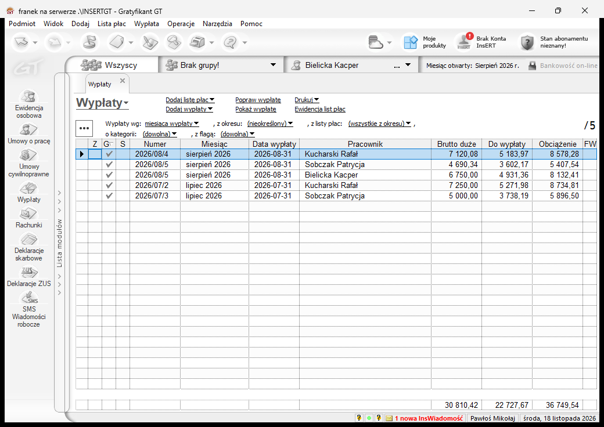

## Zadanie 16

Wygenerowana deklaracja „Zaliczka miesięczna od wypłat PIT” za sierpień 2026 (3 podatników).

## Zadanie 17

Wygenerowane naliczenie rozliczeniowe ZUS za sierpień 2026: RCA, RSA i DRA.

## Zadanie 18

Zmiana wysokości podstawy miesięcznej Rafała Kucharskiego na 7 000 zł od 1.10.2026 (wartość składnika z datą obowiązywania od 1.10.2026 w umowie o pracę).

## Zadanie 19

Dodano pracownika Dariusza Tycha, nową definicję listy płac „Pion oprogramowania” (wypłata ostatniego dnia miesiąca, zaliczka do 20., składki do 15. dnia następnego miesiąca) oraz umowę o pracę 15.09.2026–31.01.2027 (dział Oprogramowanie, programista, podstawa 7 500 zł, ulga 1/12) z definicją wypłaty „Pion oprogramowania” (wypłata główna, naliczenia i potrącenia, potrącenia komornicze, uzupełnienie do płacy minimalnej, wszystkie miesiące).

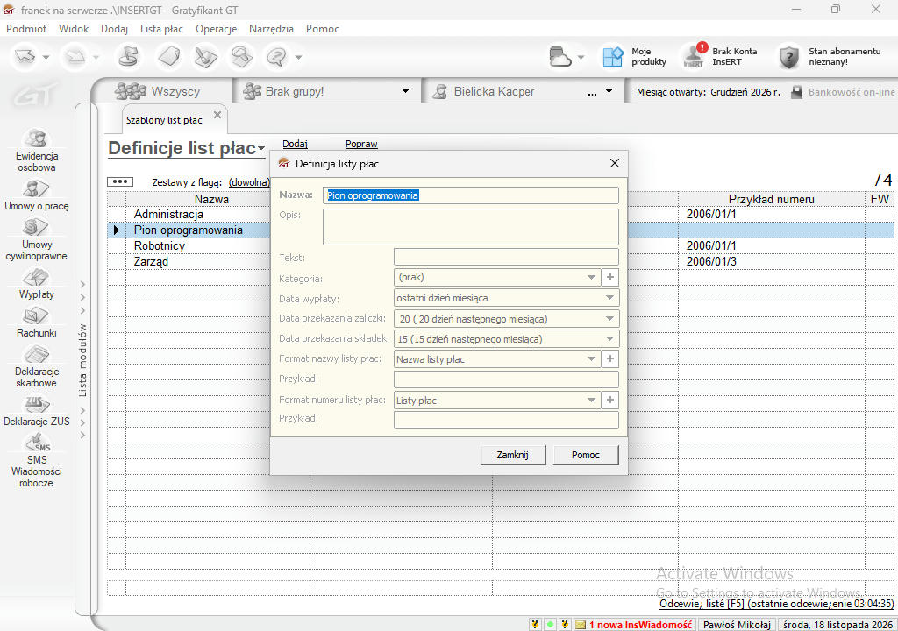

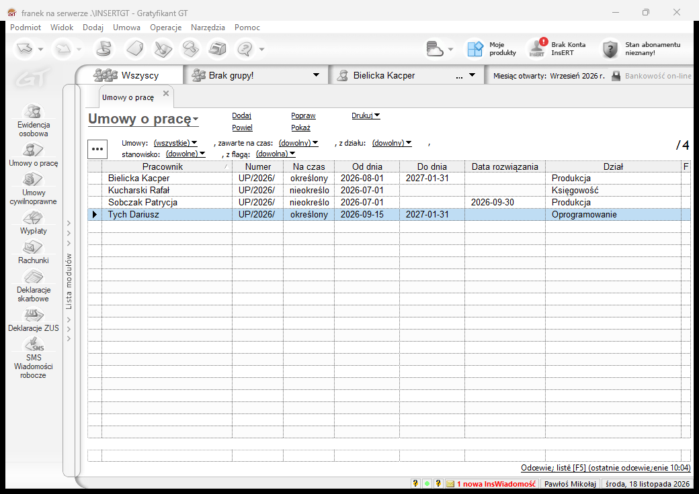

## Zadanie 20

Wygenerowana deklaracja ZUS ZUA (zgłoszenie do ubezpieczeń) dla Dariusza Tycha, data powstania obowiązku 15.09.2026.

## Zadanie 21

Umowa o pracę Patrycji Sobczak rozwiązana z dniem 30.09.2026, przyczyna: „100 – Porozumienie stron art. 30 § 1 pkt 1 k.p.” (Operacje → Rozwiąż umowę).

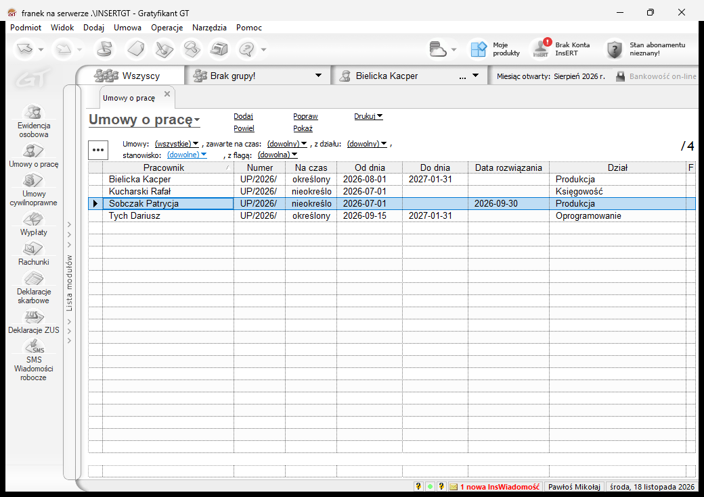

## Zadanie 22

Naliczono ekwiwalent za urlop na dzień 30.09.2026 (składniki stałe z bieżącego miesiąca, zmienne z 3 miesięcy), wypłacany w wypłacie za wrzesień 2026. W zadaniu nie podano liczby godzin, więc przyjęto 56 h (7 dni po 8 h – proporcjonalnie do 3 miesięcy zatrudnienia). Podgląd świadectwa pracy za okres 1.07–30.09.2026.

## Zadanie 23

Wygenerowana deklaracja ZUS ZWUA wyrejestrowująca Patrycję Sobczak: data zgłoszenia 30.09.2026, data wyrejestrowania 1.10.2026, kod rozwiązania stosunku pracy „24R – wypowiedzenie przez pracownika”.

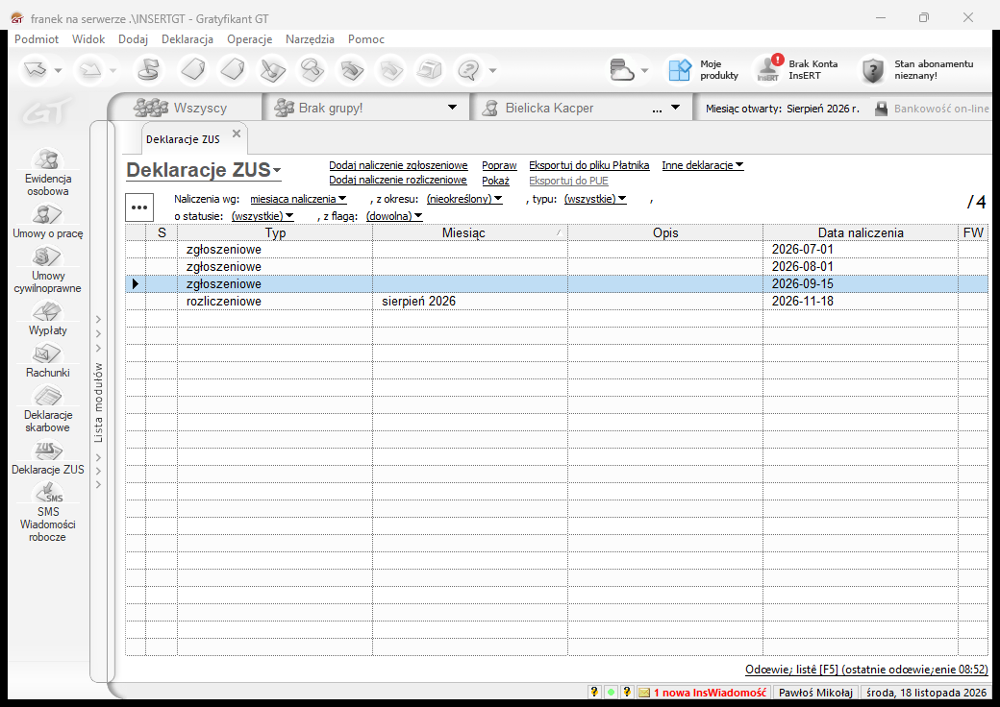

## Zadanie 24

Listy płac za wrzesień 2026 (Administracja, Robotnicy, Pion oprogramowania) oraz rachunek do umowy zlecenia (30.09.2026, 3 000 zł brutto). Pierwotnie wypłata Dariusza Tycha wyszła zerowa, bo składnik „Podstawa miesięczna” nie był przypisany do jego definicji wypłaty – po przypisaniu (zadanie 19) wypłata została wygenerowana ponownie (4 091,20 zł brutto za część miesiąca).

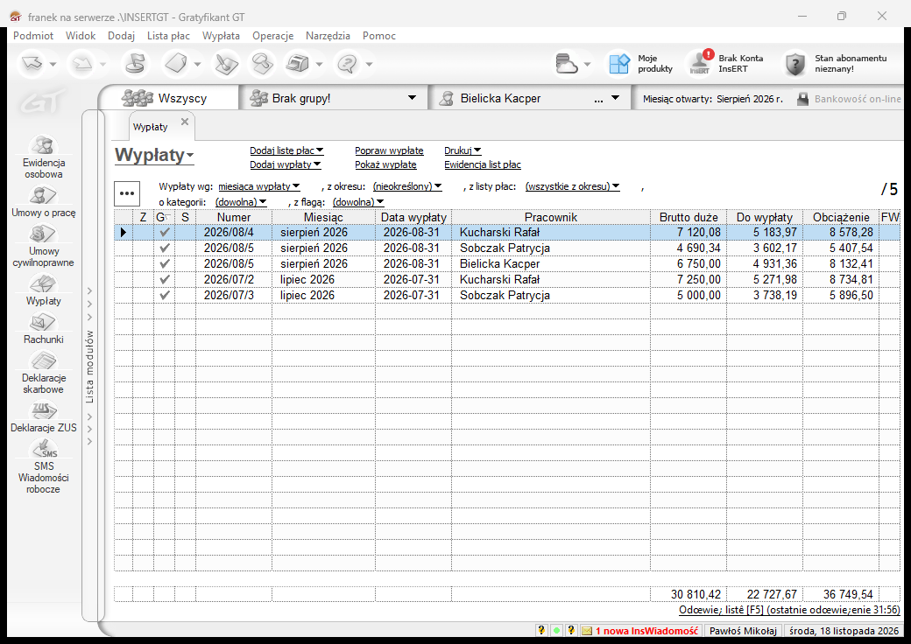

## Zadanie 25

Zaświadczenie o zatrudnieniu i wynagrodzeniu Rafała Kucharskiego z datą 1.10.2026, wynagrodzenie brutto z okresu 1.07–30.09.2026 jako suma (wg miesiąca wypłaty): 21 620,08 zł.

## Zadanie 26

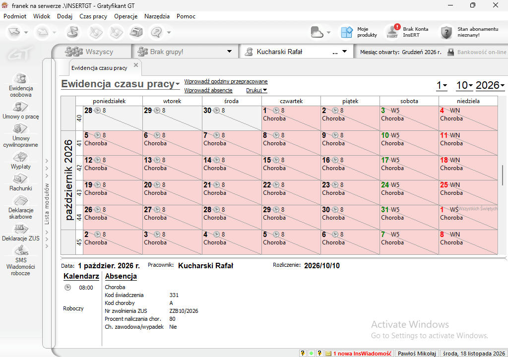

## Zadanie 27

## Zadanie 28

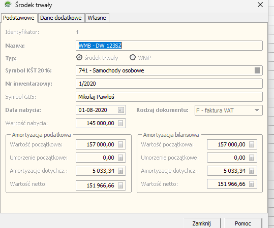

Umorzenie wynosi **5 033,34 zł**.

## Zadanie 29

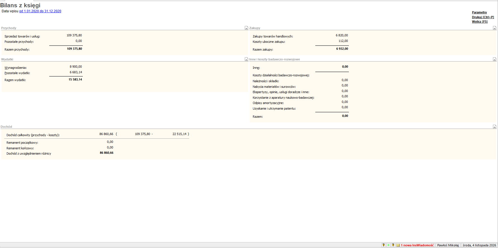

Dochód wynosi **86 860,66 zł**.

## Zadanie 30

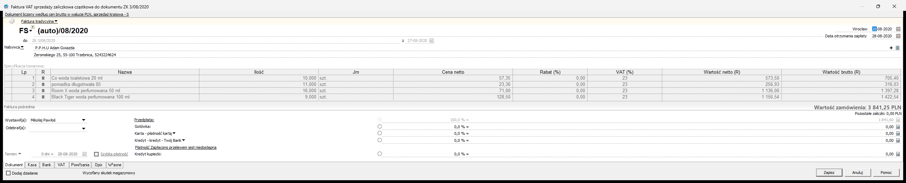

