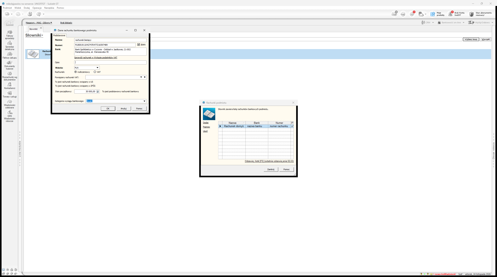
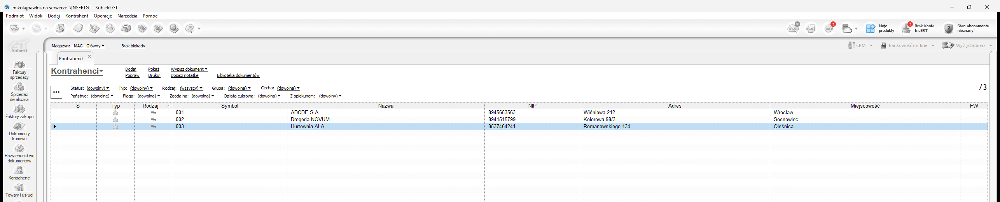
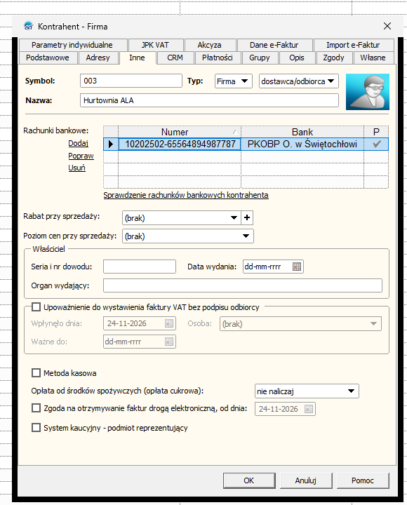
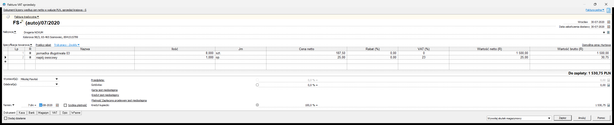
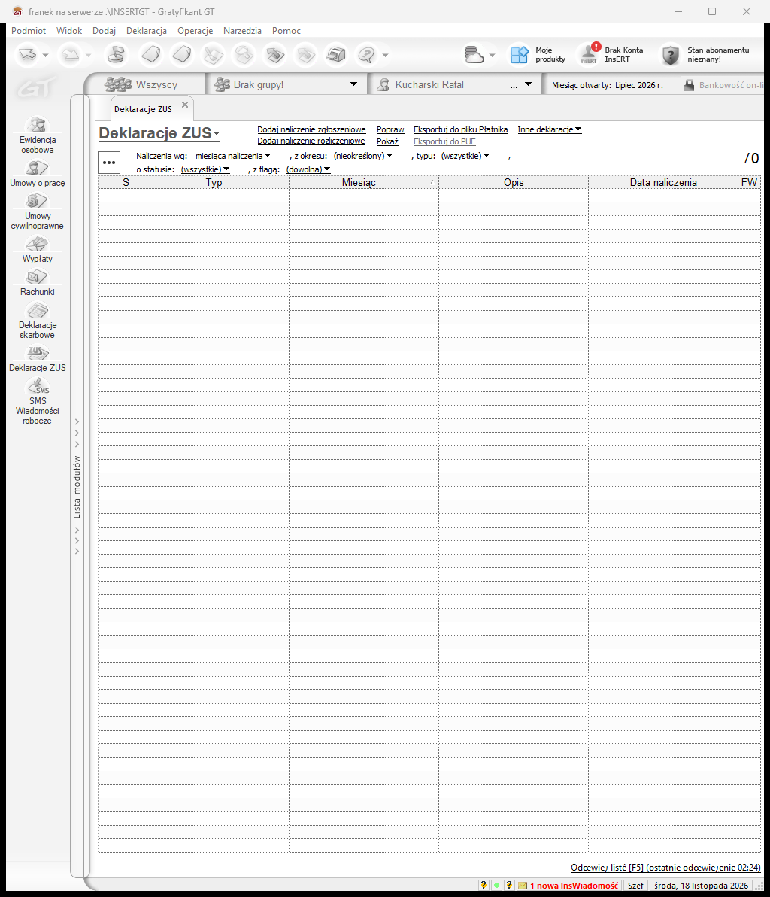
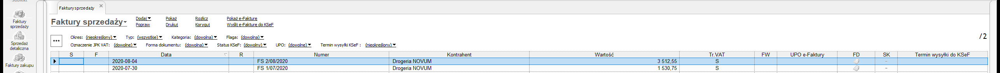
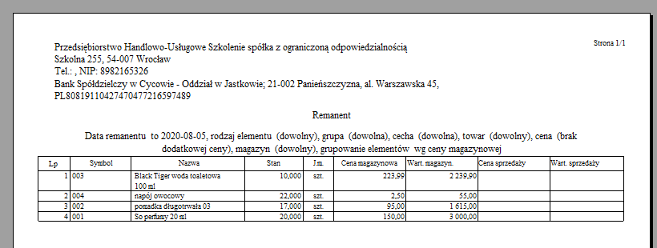

# Sprawozdanie – Subiekt GT

| | 
|---|
| **Mikołaj Pawłoś** |
| **258681** |

## Spis treści

- [Zadanie 1](#zadanie-1)
- [Zadanie 2](#zadanie-2)
- [Zadanie 3](#zadanie-3)
- [Zadanie 4](#zadanie-4)
- [Zadanie 5](#zadanie-5)
- [Zadanie 6](#zadanie-6)
- [Zadanie 7](#zadanie-7)
- [Zadanie 8](#zadanie-8)
- [Zadanie 9](#zadanie-9)

## Zadanie 1

## Zadanie 2

## Zadanie 3

## Zadanie 4

## Zadanie 5

## Zadanie 6

## Zadanie 7

## Zadanie 8

## Zadanie 9

