# Sprawozdanie – Gratyfikant GT

| | 
|---|
| **Mikołaj Pawłoś** |
| **258681** |

## Spis treści

- [Zadanie 1](#zadanie-1)
- [Zadanie 2](#zadanie-2)
- [Zadanie 3](#zadanie-3)
- [Zadanie 4](#zadanie-4)
- [Zadanie 5](#zadanie-5)
- [Zadanie 6](#zadanie-6)
- [Zadanie 7](#zadanie-7)
- [Zadanie 8](#zadanie-8)
- [Zadanie 9](#zadanie-9)
- [Zadanie 10](#zadanie-10)
- [Zadanie 11](#zadanie-11)
- [Zadanie 12](#zadanie-12)
- [Zadanie 13](#zadanie-13)
- [Zadanie 14](#zadanie-14)
- [Zadanie 15](#zadanie-15)
- [Zadanie 16](#zadanie-16)
- [Zadanie 17](#zadanie-17)
- [Zadanie 18](#zadanie-18)
- [Zadanie 19](#zadanie-19)
- [Zadanie 20](#zadanie-20)
- [Zadanie 21](#zadanie-21)
- [Zadanie 22](#zadanie-22)
- [Zadanie 23](#zadanie-23)
- [Zadanie 24](#zadanie-24)
- [Zadanie 25](#zadanie-25)
- [Zadanie 26](#zadanie-26)
- [Zadanie 27](#zadanie-27)
- [Zadanie 28](#zadanie-28)
- [Zadanie 29](#zadanie-29)
- [Zadanie 30](#zadanie-30)

## Zadanie 1

Dane firmy PHU Szkolenie sp. z o.o. wprowadzone kreatorem (szef: Mikołaj Pawłoś, identyfikator MP; pierwsza wypłata: lipiec 2026; zasiłki wypłaca ZUS; składki do 15. dnia następnego miesiąca). W zadaniu nie podano numeru NIP („NIP szkoły”), więc użyto numeru przykładowego 521-000-00-03.

## Zadanie 2

Dodani pracownicy Rafał Kucharski i Patrycja Sobczak (dane osobowe, adres, urząd skarbowy, NFZ, wykształcenie).

## Zadanie 3

Umowy o pracę od 1.07.2026: Rafał Kucharski (zestaw Administracja, podstawa 6 600 zł + premia uznaniowa 650 zł) i Patrycja Sobczak (zestaw Robotnicy, podstawa 5 000 zł).

## Zadanie 4

Wygenerowane deklaracje PIT-2 za rok 2026 dla obu pracowników.

## Zadanie 5

W obu umowach ustawiono uprawnienie do ulgi podatkowej: odliczać 1/12.

## Zadanie 6

Wygenerowane deklaracje ZUS ZUA (zgłoszenie do ubezpieczeń) dla obu pracowników, data powstania obowiązku 1.07.2026.

## Zadanie 7

Wygenerowane listy płac za lipiec 2026 (Administracja i Robotnicy), wypłaty obu pracowników obliczone poprawnie.

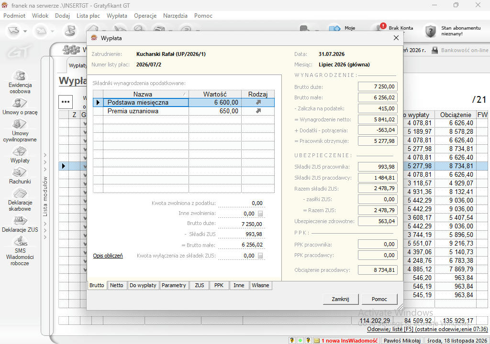

## Zadanie 8

Absencja Rafała Kucharskiego: urlop wypoczynkowy 10–13.08.2026 (4 dni). Program ostrzegł, że wymiar należnego urlopu jest mniejszy od wykorzystywanego (pracownik zatrudniony od lipca); zapis zatwierdzono zgodnie z poleceniem.

## Zadanie 9

Absencja Patrycji Sobczak: choroba 18–23.08.2026, kod choroby A, nr zwolnienia XXX08/2026, data wpłynięcia 18.08.2026, kod świadczenia 313/331.

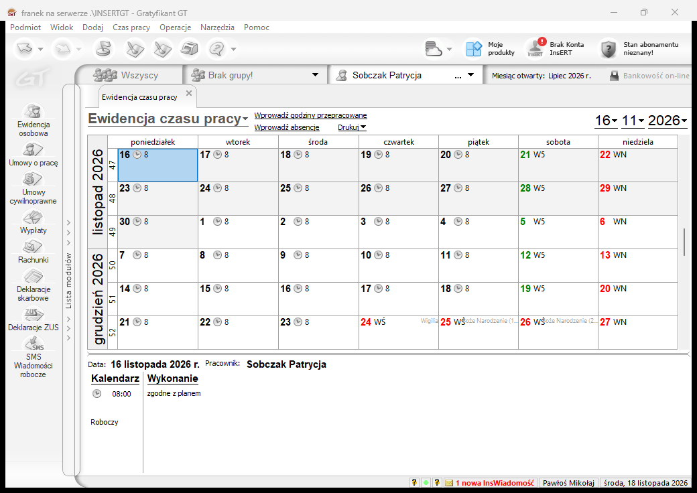

## Zadanie 10

Do dokumentu „Informacja o warunkach zatrudnienia (z regul.)” dodano punkt 6): „sposób potwierdzania przez pracowników przybycia i obecności w pracy: podpis na liście obecności”.

## Zadanie 11

Dodano pracownika Andrzeja Przybyła i jego umowę zlecenia (1.08–31.12.2026, kwota rachunku 3 000 zł, tytuł ubezpieczenia 0411, koszty 20%, zryczałtowany podatek 12%, treść: umowa zlecenia doraźnego). W programie lista dni miesiąca w harmonogramie kończy się na 28., dlatego rachunek cykliczny ustawiono na 28. dzień miesiąca (brak opcji „ostatni dzień”).

## Zadanie 12

Dodano pracownika Kacpra Bielickiego (w zadaniu: „Kacper Bielicka”) i umowę o pracę na czas określony 1.08.2026–31.01.2027 (zestaw Robotnicy, dział Produkcja, stolarz, podstawa 5 500 zł, ulga podatkowa 1/12). Wygenerowano deklaracje ZUA dla pracowników z zadań 11 i 12.

## Zadanie 13

W programie istniała już gotowa stawka „Krzesło” (20 zł), a nazwa stawki musi być unikalna, więc dodano nową stawkę liniową „krzesło - zestaw stolarza” (5 zł za sztukę). Wykonanie akordu: 250 szt. na dzień 31.08.2026, rozliczenie automatyczne – wartość 1 250 zł.

## Zadanie 14

Dla pracowników zatrudnionych na umowę o pracę (Kucharski, Sobczak, Bielicka) wprowadzono wyjątek czasu pracy: dzień wolny za święto 15.08.2026 (sobota) odebrany 17.08.2026 (typ dnia wolnego WWŚ).

## Zadanie 15

Sporządzono listy płac za sierpień 2026 oraz rachunek do umowy zlecenia (31.08.2026, brutto 3 000 zł, do wypłaty 2 106,72 zł).

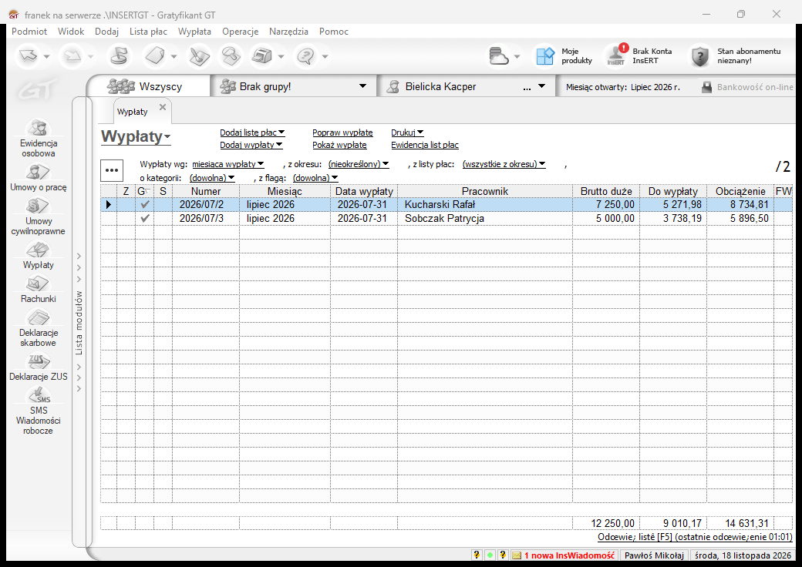

## Zadanie 16

## Zadanie 17

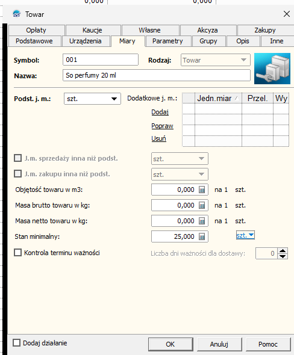

## Zadanie 18

## Zadanie 19

## Zadanie 20

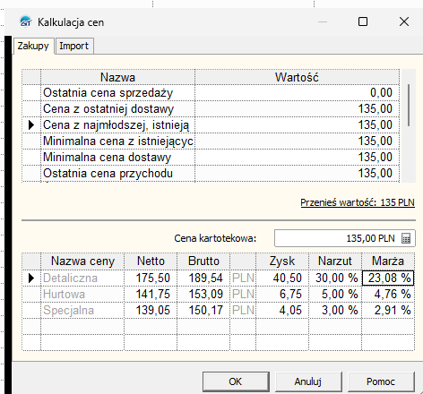

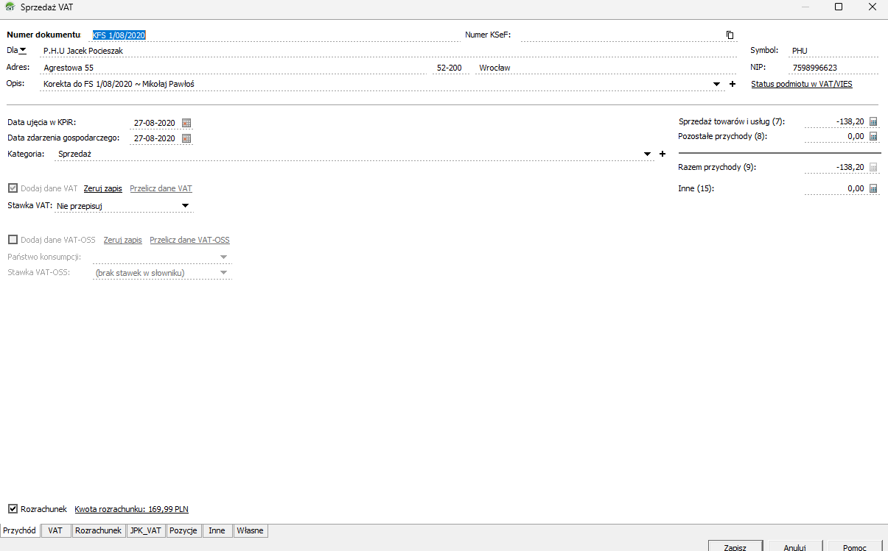

## Zadanie 21

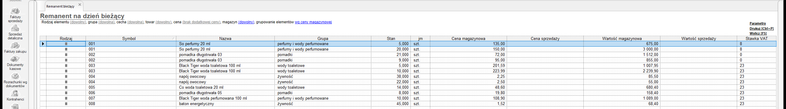

## Zadanie 22

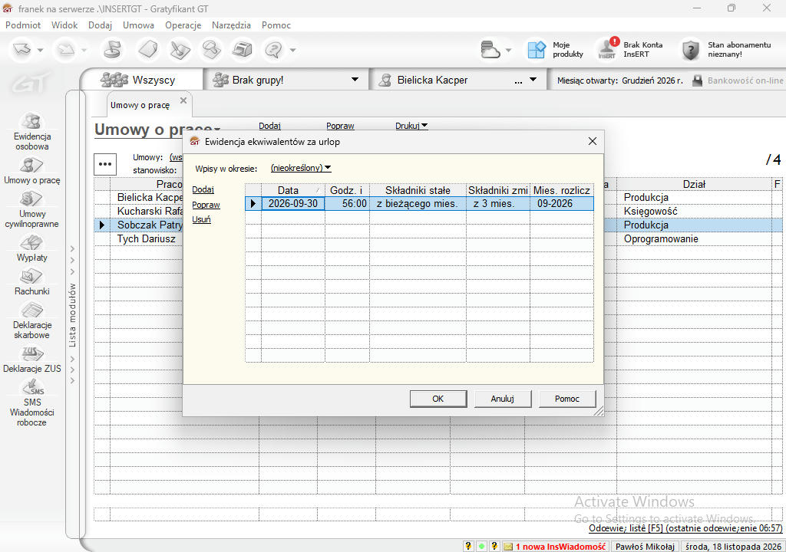

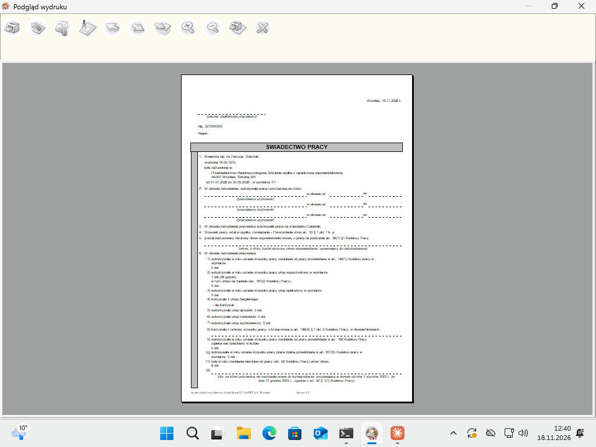

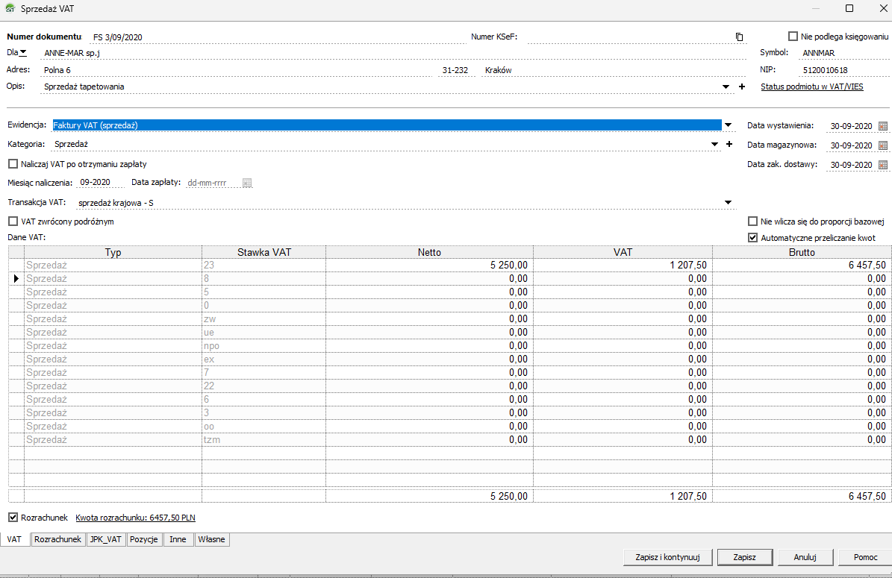

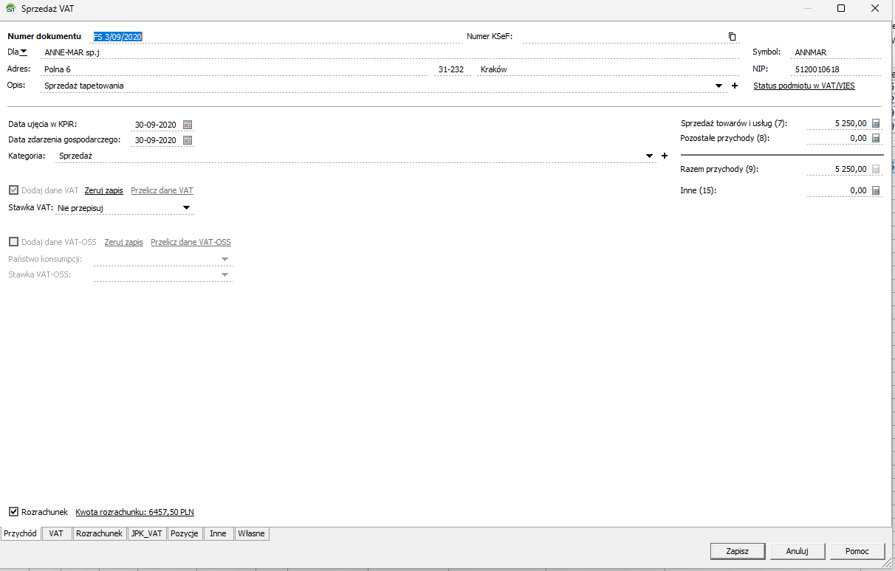

## Zadanie 23

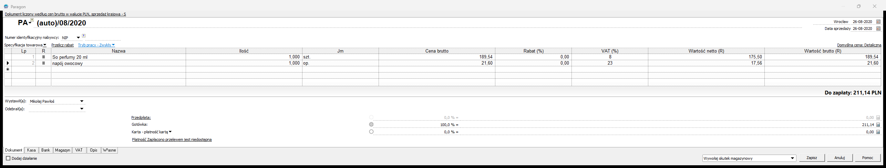

## Zadanie 24

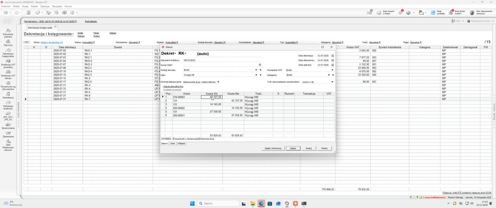

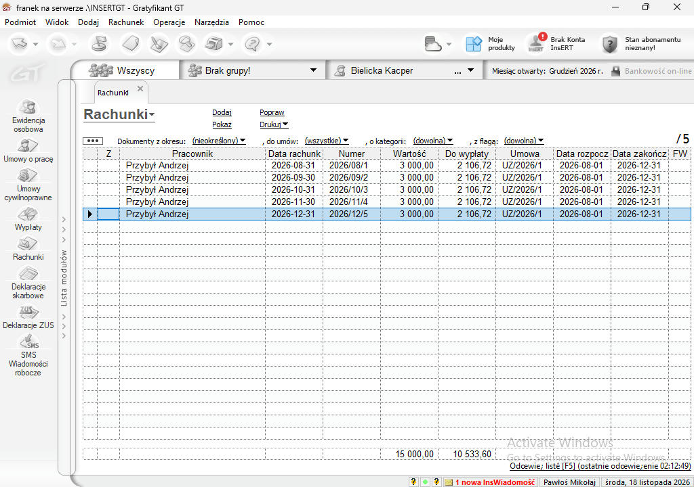

## Zadanie 25

## Zadanie 26

## Zadanie 27

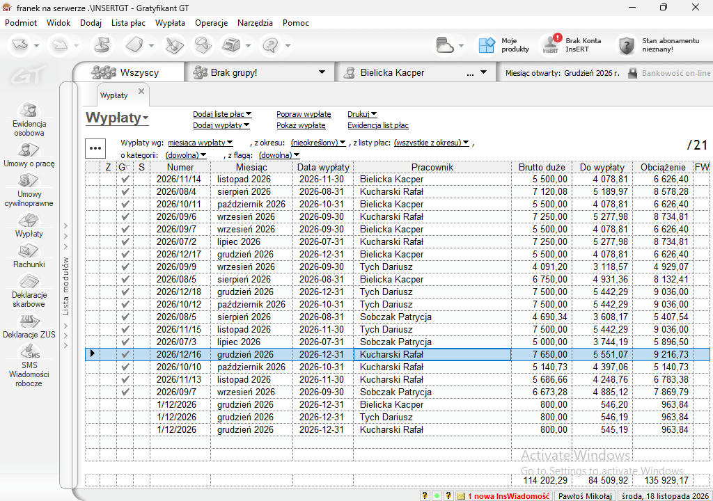

## Zadanie 28

Umorzenie wynosi **5 033,34 zł**.

## Zadanie 29

Dochód wynosi **86 860,66 zł**.

## Zadanie 30

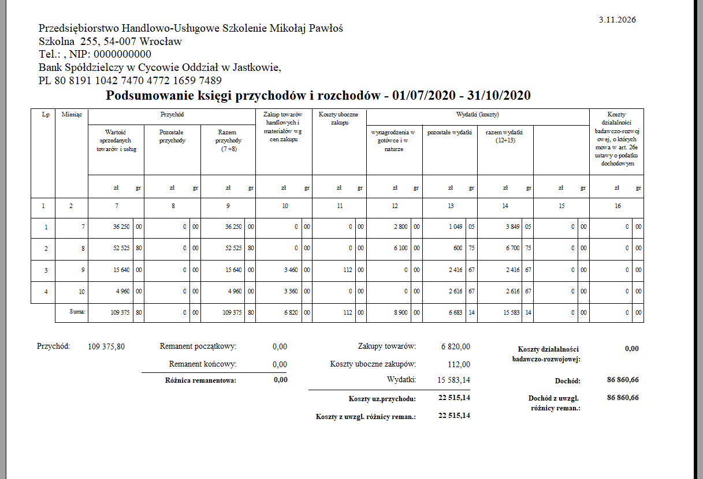

