# Sprawozdanie – Subiekt GT

| | 
|---|
| **Mikołaj Pawłoś** |
| **258681** |

## Spis treści

- [Zadanie 1](#zadanie-1)
- [Zadanie 2](#zadanie-2)
- [Zadanie 3](#zadanie-3)
- [Zadanie 4](#zadanie-4)
- [Zadanie 5](#zadanie-5)
- [Zadanie 6](#zadanie-6)
- [Zadanie 7](#zadanie-7)
- [Zadanie 8](#zadanie-8)
- [Zadanie 9](#zadanie-9)
- [Zadanie 10](#zadanie-10)
- [Zadanie 11](#zadanie-11)
- [Zadanie 12](#zadanie-12)
- [Zadanie 13](#zadanie-13)
- [Zadanie 14](#zadanie-14)
- [Zadanie 15](#zadanie-15)
- [Zadanie 16](#zadanie-16)
- [Zadanie 17](#zadanie-17)
- [Zadanie 18](#zadanie-18)
- [Zadanie 19](#zadanie-19)
- [Zadanie 20](#zadanie-20)
- [Zadanie 21](#zadanie-21)
- [Zadanie 22](#zadanie-22)
- [Zadanie 23](#zadanie-23)
- [Zadanie 24](#zadanie-24)

## Zadanie 1

## Zadanie 2

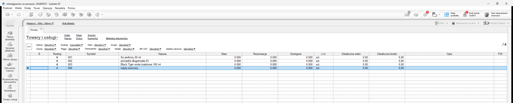

## Zadanie 3

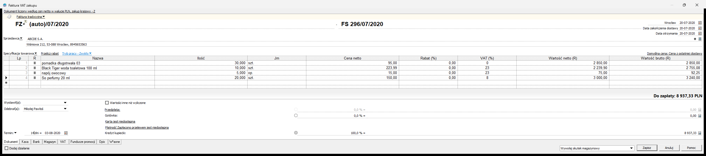

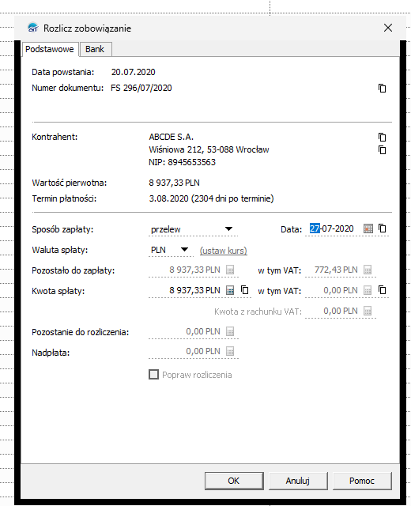

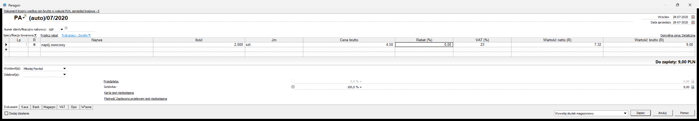

## Zadanie 4

## Zadanie 5

## Zadanie 6

## Zadanie 7

## Zadanie 8

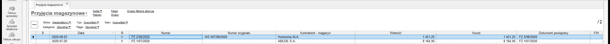

## Zadanie 9

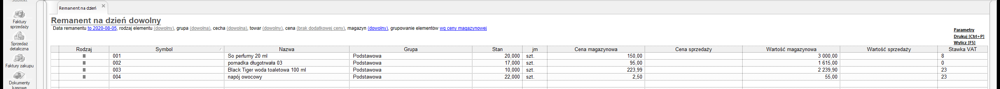

## Zadanie 10

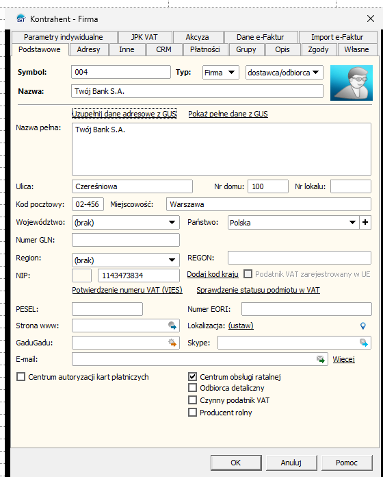

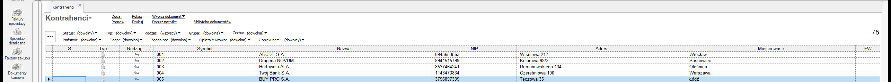

## Zadanie 11

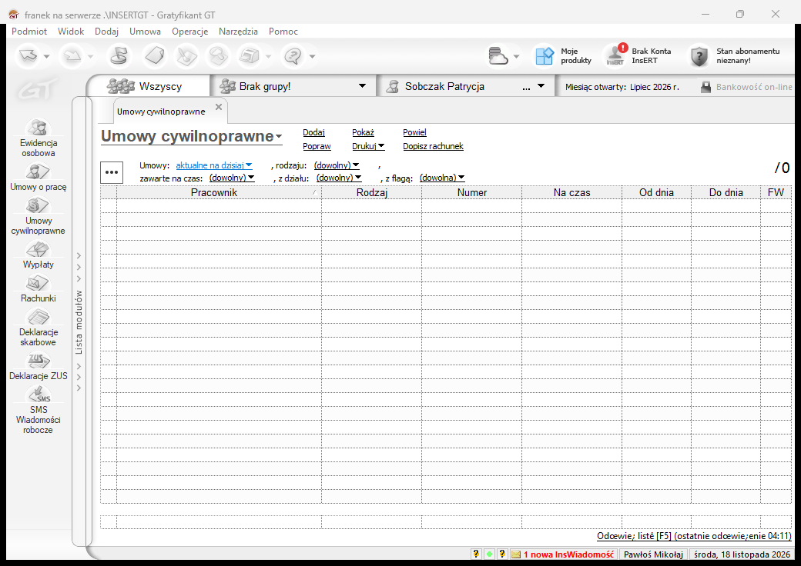

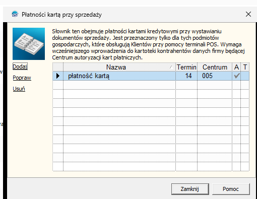

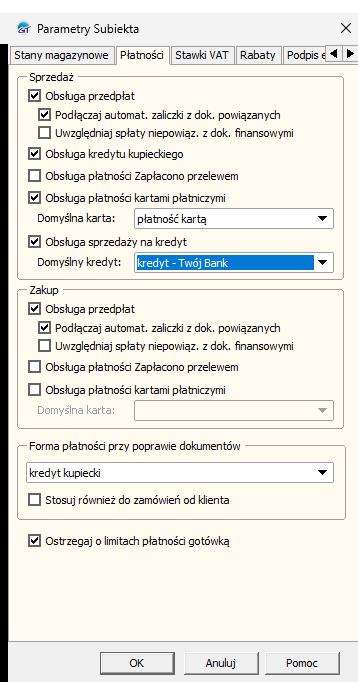

## Zadanie 12

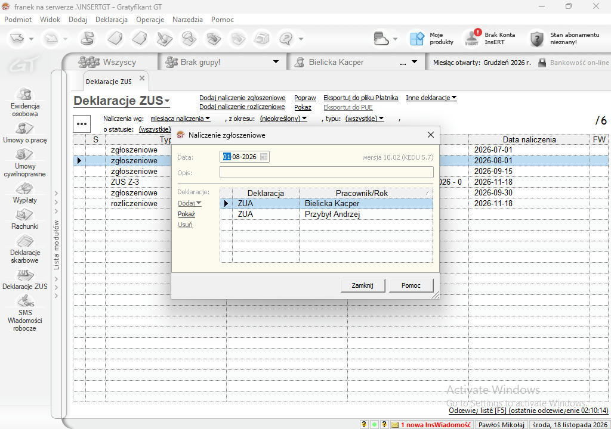

## Zadanie 13

## Zadanie 14

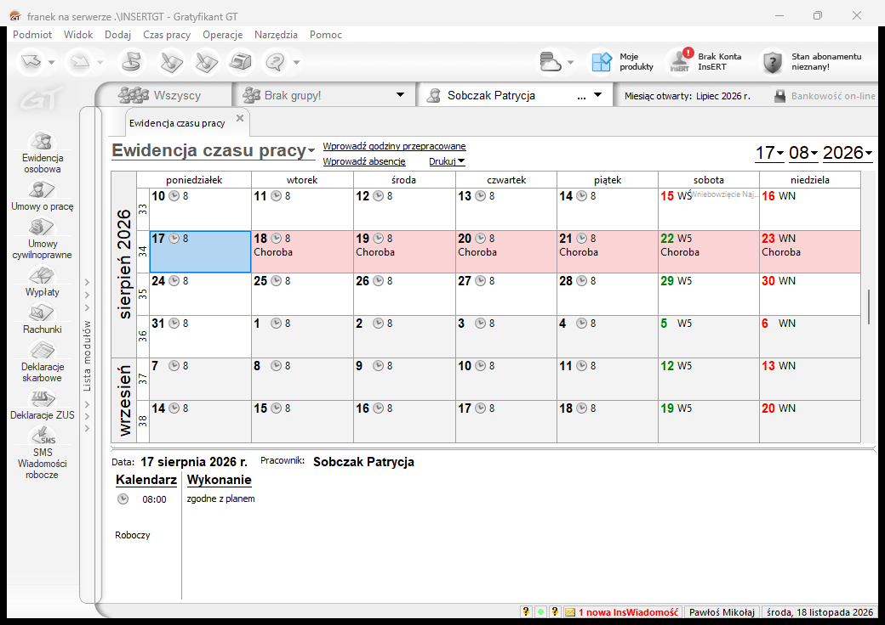

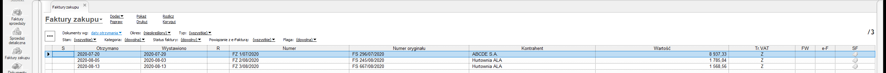

## Zadanie 15

## Zadanie 16

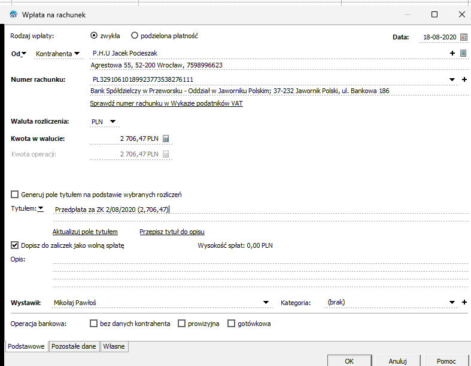

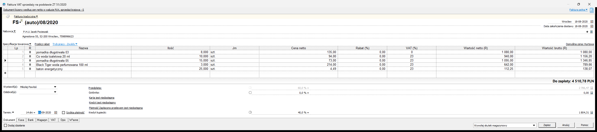

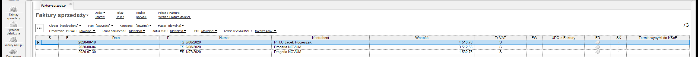

## Zadanie 17

## Zadanie 18

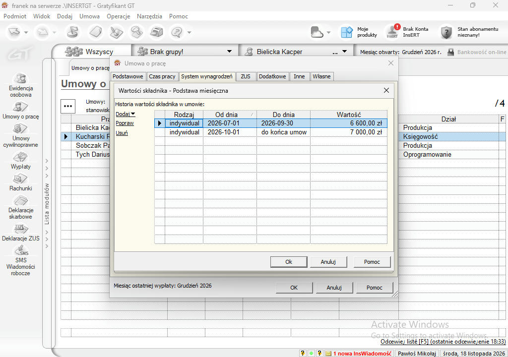

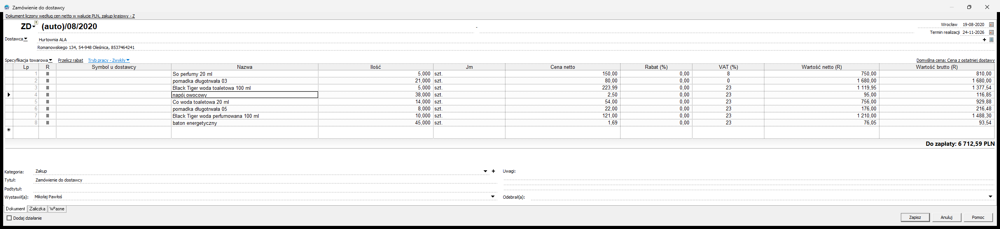

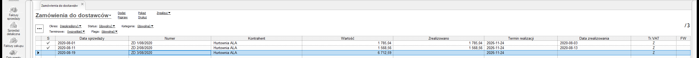

## Zadanie 19

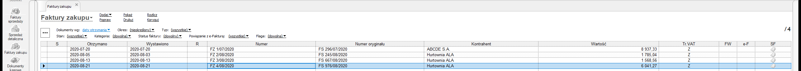

## Zadanie 20

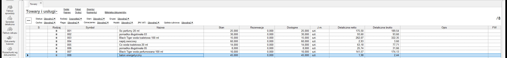

## Zadanie 21

## Zadanie 22

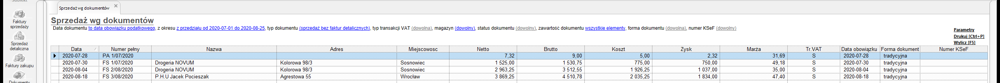

## Zadanie 23

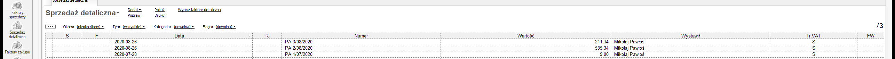

## Zadanie 24

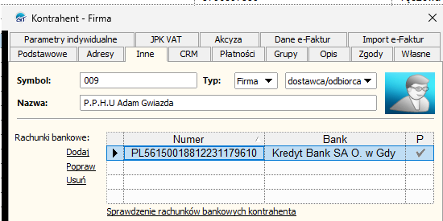

